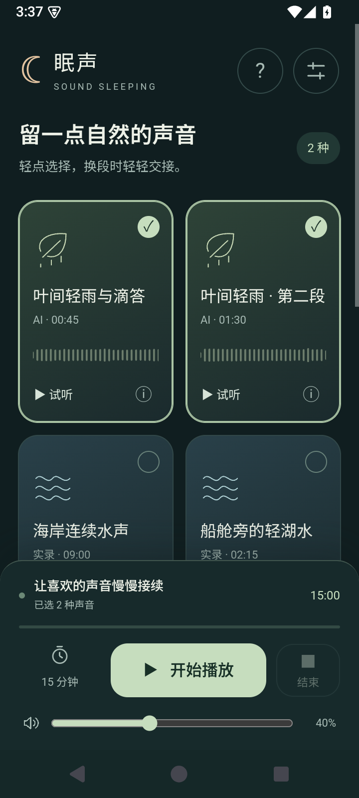
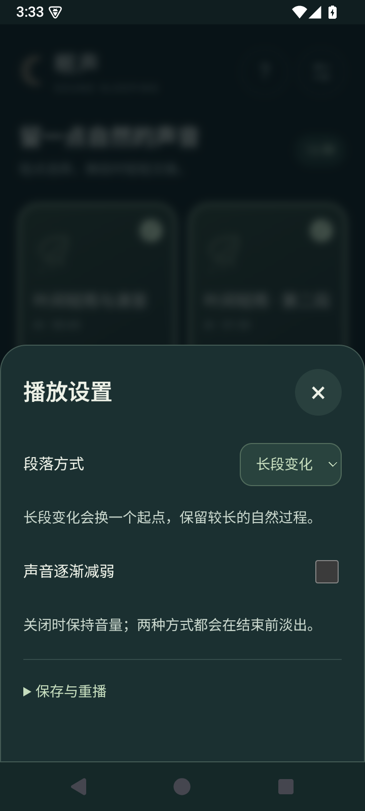
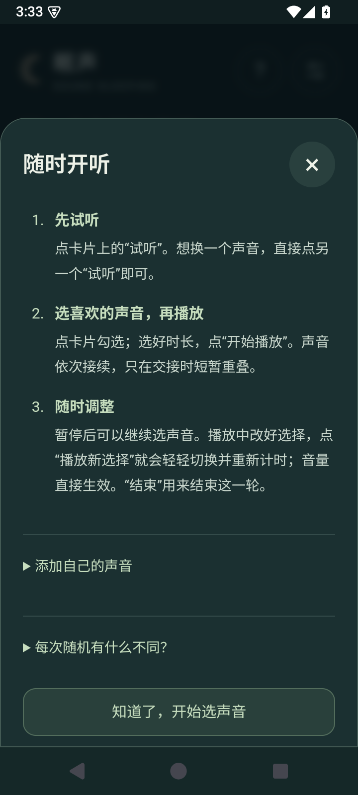

# 眠声 · Sound Sleeping

为睡前放松与日常专注设计的离线声音播放器。精选自然实录与 AI 音景，通过长片段随机接续和柔和转场减少重复感，支持添加自己的声音，适用于 Android 和电脑。

内置 13 段水声、轻雨、溪流、音铃和雨声筒，支持完整试听、长段随机接续、暂停继续、淡出结束及添加自己的音频。通常只有一段声音在播放，仅在换段时短暂交叉淡化；长播会复用素材，不会生成新的自然事件。

## 界面预览

  
  
  

首页选音 · 播放设置 · 随时开听。以上为 0.2.1 在 Android 15 模拟器中的实际界面，点击图片可查看大图。

## 下载

打开本仓库的 [Releases](https://github.com/mk3t/soundsleeping/releases)，选择 `v0.2.1` 体验版，下载下列文件。不要把 GitHub 自动附带的 “Source code” 压缩包当作播放器。

| 设备 | 推荐下载 | 备用选择 |
| --- | --- | --- |
| 安卓 | [轻量 APK](https://github.com/mk3t/soundsleeping/releases/download/v0.2.1/SoundSleeping-Android-0.2.1.apk)，约 64 MB | [Original APK](https://github.com/mk3t/soundsleeping/releases/download/v0.2.1/SoundSleeping-Android-0.2.1-Original.apk)，约 345 MB |
| 电脑 | [轻量 ZIP](https://github.com/mk3t/soundsleeping/releases/download/v0.2.1/SoundSleeping-Desktop-0.2.1.zip)，约 63 MB | [Original ZIP](https://github.com/mk3t/soundsleeping/releases/download/v0.2.1/SoundSleeping-Desktop-0.2.1-Original.zip)，约 345 MB |

想核对下载是否完整，可参照 [SHA-256 核对方法](VERIFY_DOWNLOAD.md)，与同一次 Release 的 `SHA256SUMS.txt` 比较。

轻量版使用 AAC 256 kbps；Original 版保留此前处理好的 FLAC，没有再次进行 AAC 压缩。两版功能及素材内容相同。部分实录来源是 MP3 预览，Original 不代表全部素材都是原始无损录音母带。

安卓需要 Android 8.0 或更高版本和可用的系统 WebView。下载 APK 后在手机文件管理器中打开，按系统提示允许本次安装。两个音质版本使用同一应用身份，可以覆盖切换，无需先卸载，不能作为两个应用同时安装。

电脑请完整解压 ZIP，用 Edge 或 Chrome 打开 `index.html`。保留旁边的脚本和 audio 文件夹，不需要启动服务或运行音频脚本。电脑版目前主要在 Windows / Edge 验证，其他系统与浏览器尚未逐一验证；iPhone 安装版暂未提供。

## 随时开听

1. 点声音卡片的“试听”，直接切换到另一张卡片即可换声音。
2. 勾选喜欢的声音、选择时长，点“开始播放”。
3. 播放或暂停时都可以改选；点“播放新选择”开始新一轮，音量调整立即生效。

右上角问号可以查看帮助。添加个人声音、备份和随机设置见 [使用说明](USAGE.md)。

## 当前验证情况

这是体验版。已有浏览器及 Android 模拟器检查，用户也反馈真机熄屏后可继续播放。蓝牙、真实来电、不同机型后台限制及整夜稳定性仍待验证；这不是医疗或睡眠监测工具。

如遇问题，请在 Issues 中说明机型 / 浏览器、系统版本、使用的音质版本及复现步骤。不要上传个人音频、设置备份或私人文件路径；需要这些信息时会先说明用途。

## 素材与隐私

实录分别采用 CC0、CC BY 4.0 或作者公有领域声明；部分声音由 AI 预先生成。各项来源和修改说明见 [素材来源与许可](ASSET_NOTICES.md)。应用播放时不调用 AI 服务。

应用不要求登录，没有广告或使用统计，不上传导入的音频。存储方式及外链说明见 [隐私说明](PRIVACY.md)。

## 发布安排

目前先提供可下载使用的发行版，完整开发工程计划后续开放。当前没有为自有程序代码授予开源许可证；第三方素材继续适用各自的许可。

电脑版是离线网页包，其中运行所需的 HTML、CSS、JavaScript 可以查看。这与后续公开完整开发工程、构建方法及代码许可证是两件事。
